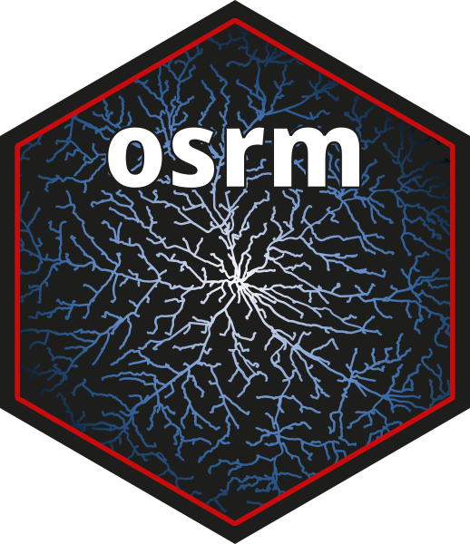
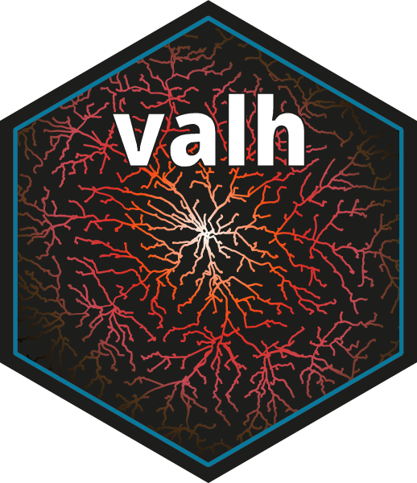

# Matrices de temps et itinéraires


 &nbsp;
 &nbsp;
  &nbsp;


Les packages `osrm` [@R-osrm] et `valh` [@R-valh] permettent d'obtenir des matrices de temps et de distances, des itinéraires routiers et des isochrones.

Ces packages servent d'interface entre R et les services de calculs
d'itinéraires [OSRM](http://project-osrm.org/) [@luxen-vetter-2011] et [Valhala](https://valhalla.github.io/valhalla/) [@Valhalla] respectivement. Ces deux services utilisent les données de la base de données OpenStreetMap. 

Les packages utilisent des serveurs de démonstration par défaut. En cas d'utilisation intensive il est fortement recommandé d'utiliser sa propre instance du service de routage avec Docker (instructions pour [OSRM](https://rcarto.github.io/posts/build_osrm_server/) et [Valhalla](https://cran.r-project.org/web/packages/valh/vignettes/install-valhalla.html)).


## Calcul d'un itinéraire
Les fonctions `osrmRoute()` et `vl_route()` permettent de calculer des itinéraires.
```{r osrmroute}
#| out-width: "75%"
#| cache: false
#| warning: false
library(sf)
library(osrm)
library(valh)
library(mapview)

com <- st_read("data/lot.gpkg", layer = "communes", quiet = TRUE)

# Itinéraire entre les centroïdes de Cahors et de Puybrun
cahors  <- st_centroid(com[com$INSEE_COM == "46042", ])
puybrun <- st_centroid(com[com$INSEE_COM == "46229", ])

# Avec OSRM
route1 <- osrmRoute(src = cahors, dst = puybrun, overview = "full")
# Avec Valhalla
route2 <- vl_route(src = cahors, dst = puybrun, server = "https://valhalla1.openstreetmap.de/")

# Visualisation des routes 
mapview(route1, map.types = "OpenStreetMap", color = "darkblue" ) + mapview(route2, color = "red4")
```


## Calcul d'une matrice de temps
Les fonctions `osrmTable()` et `vl_matrix()` permettent de calculer des matrices 
de distances ou de temps par la route.

:::{.callout-note}
## Géoréférencement d'adresses ?
Voir le point [Géoréférencement](1999_georeferencement.qmd) pour le géocodage d'adresse avec R
:::


Dans cet exemple nous calculons une matrice de temps entre 2 adresses spécifiques 
et tous les restaurants de Cahors à pied.

```{r osrmtable}
library(sf)
library(tidygeocoder)

# Import des restaurants 
restaurant <- st_read("data/lot.gpkg", layer = "restaurants", quiet = TRUE)

# Sélection des restaurants de Cahors
restaurant_cahors <- st_filter(restaurant, com[com$INSEE_COM == "46042", ])

# Construction d'un data.frame contenant deux adresses
adresses <- data.frame(ad = c("3 rue Montaudié, Cahors, France",
                              "5 rue Albert Camus, Cahors, France"))

# Geocodage de 2 adresses à Cahors
places <- geocode(.tbl = adresses, address = ad, quiet = TRUE)
places <- as.data.frame(places)
row.names(places) <- c("Rue Montaudié", "Rue Albert Camus")

# Calcul de la matrice de distance entre les 2 adresses et les 
# restaurants de Cahors
# Avec OSRM
mat1 <- osrmTable(src = places[c(3, 2)],
                  dst = restaurant_cahors[1:50, ],
                  osrm.profile = "foot")
# Avec Valhalla
mat2 <- vl_matrix(src = places[c(3, 2)],
                  dst = restaurant_cahors[1:50, ],
                  costing = "pedestrian")
mat <- cbind(t(mat1$durations), t(mat2$durations))

colnames(mat) <- c("osrm\nRue Montaudié", "osrm\nRue Albert Camus", 
                   "valh\nRue Montaudié",  "valh\nRue Albert Camus")

# Quelle adresse possède une meilleure accessibilité aux restaurants ?
boxplot(mat, cex.axis = .7, horizontal = TRUE,
        col = c("lightblue4", "lightblue4", "red4", "red4"))

```


